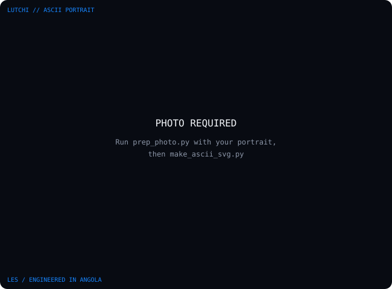

<div align="center">

# `luis@github ~ $ whoami`



**Software · IA · Automação · Produtos Digitais**

[](https://github.com/luislutchii)
[](mailto:luislutchi5@gmail.com)
[](https://lutchi.vercel.app)

</div>

---

### `📋  SYSTEM INFO`



---

### `📊  CONTRIBUTION LOG`

<h3><code>luis@github ~ $ ./contributions.sh</code></h3>


<sub>Atualizado diariamente via GitHub Actions (06:17 UTC) • Dados públicos do GitHub</sub>

---

### `👤  SOBRE MIM`

```yaml
name: "Luís Lutchi"
role: "Founder & CEO"
organization: "LES — Lutchi Enterprise Systems"
location: "Angola"
focus: [Software Engineering, AI, Automation, Digital Products]
philosophy: "build → automate → iterate → scale"
```

Sou **Luís Lutchi**, criador digital, programador e fundador da **LES — Lutchi Enterprise Systems**. Construo soluções digitais que combinam desenvolvimento de software, inteligência artificial, automação e monetização para escalar negócios com eficiência, performance e segurança.

---

### `🛠  O QUE CONSTRUO`

| Domínio | Descrição |
|---------|-----------|
| **🤖 IA & Automação** | Ferramentas, fluxos de trabalho e agentes assistidos por IA |
| **💬 Bots & Integrações** | Telegram, WhatsApp, Discord — automações conversacionais |
| **🌐 Desenvolvimento Web** | Plataformas, dashboards, APIs REST/GraphQL, microfrontends |
| **💳 Fintech & Pagamentos** | Gateways, split de pagamentos, marketplace digital |
| **📱 Mobile** | Aplicações nativas e híbridas (Android, React Native) |
| **🎨 Design Digital** | UI/UX, design systems, identidade visual, motion design |

---

### `🚀  PROJETOS EM DESTAQUE`

| Projeto | Descrição | Stack | Status |
|---------|-----------|-------|--------|
| **CodeLES** | IA para desenvolvimento via CLI — geração, review, refactor | TypeScript, Node.js, LLMs | 🟢 Ativo |
| **VibePay** | Gateway de pagamentos para negócios digitais — split, webhooks, conciliação | Node.js, PostgreSQL, Redis | 🟡 Beta |
| **LutchiCash** | Marketplace de produtos digitais — vitrine, checkout, entrega automática | Next.js, Supabase, Stripe | 🟢 Produção |

---

### `💻  STACK & FERRAMENTAS`

**Linguagens & Runtime**
`Python` · `JavaScript` · `TypeScript` · `Node.js` · `Rust` · `Go`

**Frontend & UI**
`React` · `Next.js` · `Tailwind CSS` · `Framer Motion` · `Shadcn/UI` · `Three.js`

**Backend & Infra**
`Fastify` · `PostgreSQL` · `Supabase` · `Redis` · `Docker` · `Kubernetes` · `Terraform`

**Cloud & DevOps**
`Vercel` · `AWS` · `Oracle Cloud` · `Fly.io` · `GitHub Actions` · `PM2`

**IA & Dados**
`Transformers.js` · `Whisper.cpp` · `Baileys` · `LangChain` · `Vector DBs`

**Mobile & Desktop**
`Tauri v2` · `React Native` · `Android (Kotlin)` · `Nuitka`

---

### `📬  CONTATO`

| Canal | Link |
|-------|------|
| **GitHub** | [@luislutchii](https://github.com/luislutchii) |
| **Email Pessoal** | [luislutchi5@gmail.com](mailto:luislutchi5@gmail.com) |
| **LES / Suporte** | [loja@lutchicash.online](mailto:loja@lutchicash.online) |
| **Website LES** | [lutchi.vercel.app](https://lutchi.vercel.app) |
| **WhatsApp** | [+244 954 337 951](https://wa.me/244954337951) |

---

<div align="center">

<sub><code>build → automate → iterate → scale</code></sub><br/>
<sub>Luís Lutchi · LES — Lutchi Enterprise Systems · Engineered in Angola</sub>

</div>